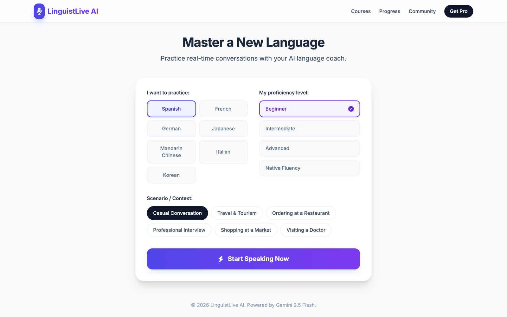

# LinguistLive

[](https://github.com/otawfik/LinguistLive/actions/workflows/ci.yml)

**Practice a language by actually speaking it — a real-time voice conversation with an AI
coach that adapts to your level.**



## What it does

Pick one of seven languages (Spanish, French, German, Japanese, Mandarin, Italian, Korean), a
level from beginner to native fluency, and a scenario — casual conversation, ordering at a
restaurant, a job interview, shopping, a doctor's visit. Then talk. The coach answers out loud,
stays in character for the scenario, keeps sentences short for beginners, corrects mistakes by
rephrasing them naturally, and drops in an English translation when you're stuck.

## How it works

Voice runs over the **Gemini Live API** (`gemini-2.5-flash-native-audio`): microphone audio is
captured at 16 kHz, encoded to PCM and streamed over a WebSocket; the model's spoken reply
streams back at 24 kHz and plays as it arrives, with live transcription of both sides.

**The API key never reaches the browser.** A live WebSocket session can't be proxied like a
normal request, so the server function `api/live-token.ts` mints a short-lived, single-use
**ephemeral token** locked to that one model, and the browser connects with the token instead.

## Run locally

```bash
npm install
echo "GEMINI_API_KEY=your-key" > .env.local   # never committed
npm run dev
```

Vite answers `/api/live-token` in development with the same server function. Deploys to Vercel
as-is; set `GEMINI_API_KEY` in the project's environment variables. Microphone access needs
HTTPS (or localhost).

## Stack

React 19 · TypeScript · Vite · Web Audio API · Gemini Live API · Vercel Functions
